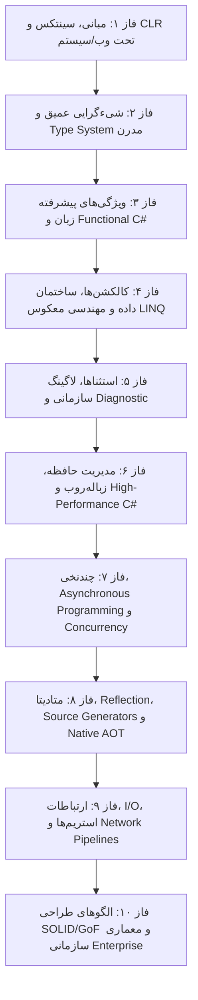
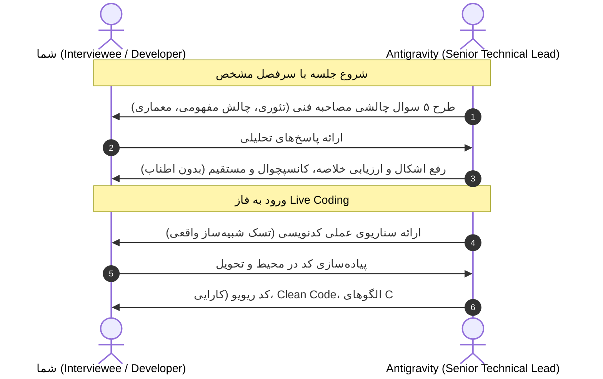

# 🚀 برنامه جامع، گام‌به‌گام و مصاحبه‌محور مستری C# و اکوسیستم .NET (مقدماتی تا معماری)

> **روش‌شناسی:** این برنامه به صورت مرحله‌به‌مرحله با استراتژی **«۵ سوال مصاحبه فنی + ۱ سناریوی Live Coding»** طراحی شده است. پس از پاسخ‌گویی به سوالات هر مرحله، رفع اشکال بصورت **خلاصه، شفاف و بدون اضافه‌گویی** ارائه شده و بلافاصله وارد چالش کدنویسی زنده می‌شویم.

---

## 🧭 نقشه راه کلی در یک نگاه (Curriculum Overview)

---

## 📋 جدول جامع مباحث، سرفصل‌ها و جلسات

| فاز | کد جلسه | عنوان مبحث | پیش‌نیاز | مفاهیم کلیدی مورد بررسی در مصاحبه و Live Coding | وضعیت |
|:---|:---:|:---|:---:|:---|:---:|
| **۱** | **S01** | **اکوسیستم .NET و معماری اجرای کد** | - | CLI, CLR, CTS, CLS, BCL, JIT, IL (MSIL), AOT vs JIT, Assembly Structure | ✅ تکمیل شد (مصاحبه + کارگاه) |
| **۱** | **S02** | **سیستم انواع داده و حافظه اولیه** | S01 | Primitive Types, Value Types vs Reference Types, Memory Layout (Stack vs Heap مقدماتی) | ✅ تکمیل شد (مصاحبه + کارگاه) |
| **۱** | **S03** | **تبدیل انواع، عملیات و Boxing/Unboxing** | S02 | Implicit/Explicit Casting, `is`/`as`, Boxing/Unboxing Overhead, Operators, Checked/Unchecked | ✅ تکمیل شد (مصاحبه + کارگاه) |
| **۱** | **S04** | **جریان کنترل و ساختارهای تصمیم مدرن** | S03 | Pattern Matching Switch, Switch Expressions, Guard Clauses, Loops, Loop Invariants | ✅ تکمیل شد (مصاحبه + کارگاه) |
| **۱** | **S05** | **متدها، پارامترها و قواعد فراخوانی** | S04 | `in`, `out`, `ref`, `params` (Collections در C# 13), Overloading, Local Functions | ⏳ در حال انجام |
| **۲** | **S06** | **مبانی شیءگرایی: کپسوله‌سازی و انواع کلاس** | S05 | Encapsulation, Access Modifiers, Classes, Constructors, Primary Constructors (C# 12/13) | ⏳ برنامه‌ریزی شده |
| **۲** | **S07** | **وراثت و چندریختی (Inheritance & Polymorphism)** | S06 | `virtual`, `override`, `new` (shadowing), `abstract`, `sealed`, Base Calling, VTable | ⏳ برنامه‌ریزی شده |
| **۲** | **S08** | **اینترفیس‌ها و قراردادهای نرم‌افزاری** | S07 | Interface Segregation, Explicit Implementation, Default Interface Methods (DIM), Static Abstract Members | ⏳ برنامه‌ریزی شده |
| **۲** | **S09** | **استراکت‌ها و مقایسه بنیادین با کلاس** | S07 | `struct`, Memory Allocations, Mutability Hazards, `readonly struct`, Passing by `ref` | ⏳ برنامه‌ریزی شده |
| **۲** | **S10** | **رکوردها و برابری بر پایه مقادیر** | S09 | `record class`, `record struct`, Value-based Equality, `with` Expressions, Immutability | ⏳ برنامه‌ریزی شده |
| **۳** | **S11** | **ژنریک‌ها (Generics) و محدودیت‌ها (Constraints)** | S08 | Generic Classes/Methods, Type Safety, Performance (Zero-boxing), Constraints (`where T : ...`) | ⏳ برنامه‌ریزی شده |
| **۳** | **S12** | **واریانس در ژنریک‌ها: Covariance و Contravariance** | S11 | `out` (Covariance), `in` (Contravariance), Invariance, کاربرد در `IEnumerable<out T>` و `Action<in T>` | ⏳ برنامه‌ریزی شده |
| **۳** | **S13** | **سیستم ایمنی نال (Nullable Reference Types - NRT)** | S10 | NRT, Null-forgiving (`!`), Null-conditional (`?.`), Null-coalescing (`??`, `??=`), Flow Analysis | ⏳ برنامه‌ریزی شده |
| **۳** | **S14** | **الگوخوانی مدرن (Deep Pattern Matching)** | S13 | Type, Relational, Positional, Property, Tuple, List/Slice Patterns (`[1, .., _]`) | ⏳ برنامه‌ریزی شده |
| **۳** | **S15** | **دلیگیت‌ها، لامبدا و برنامه‌نویسی تابعی** | S11 | Delegates, `Func<T>`, `Action<T>`, `Predicate<T>`, Anonymous Methods, Lambdas, Closures & Heap Allocation | ⏳ برنامه‌ریزی شده |
| **۳** | **S16** | **رویدادها (Events) و الگوی Publisher-Subscriber** | S15 | Events vs Delegates, Thread-safe Invocations, Memory Leaks via Event Handlers, Weak Events | ⏳ برنامه‌ریزی شده |
| **۴** | **S17** | **کالکشن‌های پایه و تحلیل زمانی O(n)** | S11 | `Array`, `List<T>`, `Dictionary<TKey, TValue>`, `HashSet<T>`, Hash Collision, Capacity Growth | ⏳ برنامه‌ریزی شده |
| **۴** | **S18** | **ساختمان داده‌های پیشرفته و تخصص‌یافته** | S17 | `Queue<T>`, `Stack<T>`, `LinkedList<T>`, `PriorityQueue<TElement, TPriority>`, `SortedDictionary` | ⏳ برنامه‌ریزی شده |
| **۴** | **S19** | **کالکشن‌های تغییرناپذیر و فقط‌خواندنی** | S17 | `IReadOnlyCollection`, `ReadOnlyCollection<T>`, `ImmutableList<T>`, `ImmutableArray<T>` | ⏳ برنامه‌ریزی شده |
| **۴** | **S20** | **مکانیزم درونی LINQ و تله‌های پرفورمنس** | S15 | `IEnumerable<T>`, `IEnumerator<T>`, `yield return`, Deferred Execution, Multiple Enumeration Trap | ⏳ برنامه‌ریزی شده |
| **۴** | **S21** | **عملگرهای پیشرفته LINQ و درک Expression Trees** | S20 | `SelectMany`, `GroupBy`, `Join`, `Aggregate`, `IQueryable<T>` vs `IEnumerable<T>`, Expression Trees | ⏳ برنامه‌ریزی شده |
| **۵** | **S22** | **مدیریت استثناها و فیلترهای خطا** | S06 | Exception Hierarchy, Exception Handling Best Practices, `throw;` vs `throw ex;`, Exception Filters (`when`) | ⏳ برنامه‌ریزی شده |
| **۵** | **S23** | **لاگینگ، ردیابی و Observability مدرن** | S22 | `ILogger`, Structured Logging, Semantic Logging, EventSource, Activity & OpenTelemetry | ⏳ برنامه‌ریزی شده |
| **۶** | **S24** | **ساختار حافظه CLR و چرخه حیات شیء** | S09 | Object Header, MethodTable Pointer, SyncBlock Index, Stack vs Heap Allocation, Memory Alignment | ⏳ برنامه‌ریزی شده |
| **۶** | **S25** | **زباله‌روب عمیق (.NET Garbage Collector)** | S24 | Gen 0/1/2, LOH (Large Object Heap), POH (Pinned Object Heap), Server vs Workstation GC, Background GC | ⏳ برنامه‌ریزی شده |
| **۶** | **S26** | **الگوی آزادسازی منابع غیرمدیریت‌شده (IDisposable)** | S25 | `IDisposable`, `IAsyncDisposable`, Dispose Pattern, Finalizer (`~Class`), `GC.SuppressFinalize` | ⏳ برنامه‌ریزی شده |
| **۶** | **S27** | **برنامه‌نویسی High-Performance با Span و Memory** | S26 | `Span<T>`, `ReadOnlySpan<T>`, `Memory<T>`, Zero-allocation Slicing, Stack-only safety | ⏳ برنامه‌ریزی شده |
| **۶** | **S28** | **بهینه‌سازی پیشرفته حافظه و Ref Structs** | S27 | `ref struct` (پیاده‌سازی اینترفیس در C# 13), `ArrayPool<T>`, `MemoryPool<T>`, `stackalloc` | ⏳ برنامه‌ریزی شده |
| **۶** | **S29** | **برنامه‌نویسی ناامن (Unsafe & Native Interop)** | S28 | `unsafe`, Pointers, `fixed`, P/Invoke, `Unsafe` class, Native Memory Management | ⏳ برنامه‌ریزی شده |
| **۷** | **S30** | **مبانی تردها، ThreadPool و Synchronization** | S06 | `Thread`, `ThreadPool`, Synchronization Primitives (`Monitor`, `Mutex`, `SemaphoreSlim`) | ⏳ برنامه‌ریزی شده |
| **۷** | **S31** | **سینکرونایزیشن مدرن و قفل‌های بهینه** | S30 | `lock`, کلمه کلیدی جدید `System.Threading.Lock` (در C# 13), `ReaderWriterLockSlim` | ⏳ برنامه‌ریزی شده |
| **۷** | **S32** | **برنامه‌نویسی بدون قفل (Lock-Free) و اتمیک** | S31 | `Interlocked` class, Memory Barriers, CPU Cache Coherency, `Volatile` keyword | ⏳ برنامه‌ریزی شده |
| **۷** | **S33** | **الگوی TAP و موتور درونی Async/Await** | S30 | `Task`, `Task<T>`, `ValueTask<T>`, Async State Machine (`IAsyncStateMachine`), MoveNext | ⏳ برنامه‌ریزی شده |
| **۷** | **S34** | **کانتکست‌ها و بهینه‌سازی Task در سرور و کلاینت** | S33 | `SynchronizationContext`, `ExecutionContext`, `ConfigureAwait(false)`, Deadlocks | ⏳ برنامه‌ریزی شده |
| **۷** | **S35** | **همزمانی پیشرفته: Channels و Reactive Patterns** | S33 | `System.Threading.Channels` (Producer-Consumer بدون قفل), `Parallel.ForEachAsync`, PLINQ | ⏳ برنامه‌ریزی شده |
| **۸** | **S36** | **ویژگی‌ها (Attributes) و Reflection عمیق** | S08 | Custom Attributes, Metadata Inspection, Method Invocation, Dynamic Instantiation, Perf Penalties | ⏳ برنامه‌ریزی شده |
| **۸** | **S37** | ** Roslyn Source Generators و Native AOT** | S36 | Roslyn Compiler API, Incremental Source Generators, Native AOT Readiness, Reflection-free Code | ⏳ برنامه‌ریزی شده |
| **۹** | **S38** | **استریم‌ها، فایل‌ها و Pipelines با کارایی بالا** | S27 | `Stream`, `FileStream`, `MemoryStream`, `System.IO.Pipelines` (Zero-copy network/disk I/O) | ⏳ برنامه‌ریزی شده |
| **۹** | **S39** | **سریال‌سازی مدرن JSON و شبکه‌سازی ایمن** | S38 | `System.Text.Json` (Source Generation), `HttpClientFactory`, Resilience (Polly), Sockets | ⏳ برنامه‌ریزی شده |
| **۱۰** | **S40** | **اصول پنج‌گانه SOLID در پروژه‌های مدرن C#** | S08 | Single Responsibility, Open-Closed, Liskov, Interface Segregation, Dependency Inversion در عمل | ⏳ برنامه‌ریزی شده |
| **۱۰** | **S41** | **الگوهای طراحی سازنده و ساختاری (Creational & Structural)** | S40 | Factory Method, Abstract Factory, Builder, Singleton, Decorator, Adapter, Proxy | ⏳ برنامه‌ریزی شده |
| **۱۰** | **S42** | **الگوهای طراحی رفتاری (Behavioral Patterns)** | S41 | Strategy, Observer, Mediator, Command, Chain of Responsibility | ⏳ برنامه‌ریزی شده |
| **۱۰** | **S43** | **تزریق وابستگی عمیق (Dependency Injection)** | S40 | `IServiceCollection`, Lifetimes (Transient, Scoped, Singleton), Captive Dependency Trap, Factory Pattern with DI | ⏳ برنامه‌ریزی شده |
| **۱۰** | **S44** | **معماری تمیز، الگوهای Enterprise و آماده‌سازی مصاحبه معمار نرم‌افزار** | S43 | Clean Architecture, CQRS, Vertical Slice, Repository/UnitOfWork Pros & Cons, Senior Assessment | ⏳ برنامه‌ریزی شده |

---

## 🎯 متدولوژی و پروتکل اجرایی هر جلسه

---

## 💡 قوانین طلایی برای بازخورد و رفع اشکال:
1. **خلاصه و رسا بودن:** اجتناب از کلی‌گویی و حاشیه‌پردازی؛ تمرکز مستقیم روی مغز مطلب (Core Concept).
2. **بررسی Under the Hood:** تحلیل پشت صحنه اینکه CLR و کامپایلر دقیقاً چه کاری انجام می‌دهند.
3. **تطبیق با استانداردهای مدرن:** تمرکز روی C# 12 و C# 13 در کنار پایه‌های محکم .NET 8 و .NET 9.
